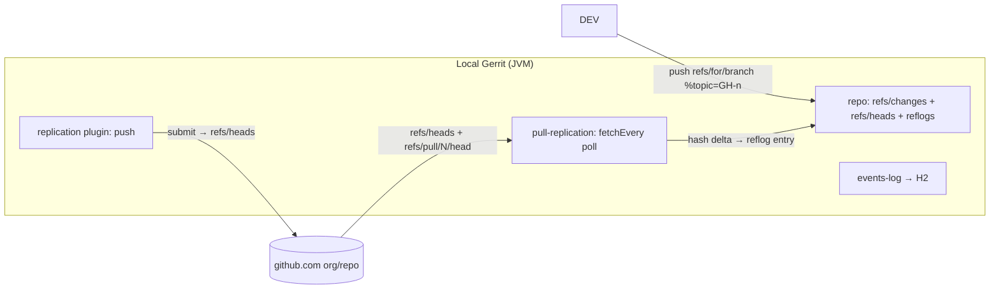

<!-- source: omp session 01a12ba7-881d-7000-85d5-c9e58f29319b, 2026-10-11 -->

# Gerrit ↔ GitHub local mirror: prior art, mechanisms, memory

## 1. Prior art — done before, repeatedly

| Deployment | Direction | Mechanism |
|---|---|---|
| Wikimedia (gerrit.wikimedia.org → github.com/wikimedia) | Gerrit canonical, GitHub read-only mirror, PRs rejected by bot | `replication` plugin push; AI overview + Phabricator task T37497 confirm setup |
| OpenStack, MediaWiki | Both coexisting | Listed as established Gerrit+GitHub users in the GitHub plugin README |
| GerritHub.io (GerritForge) | GitHub repos as Gerrit projects, bidirectional | `github` plugin: OAuth, push+pull replication, PR→Change import |
| ONAP + LF projects (via `github2gerrit`) | Gerrit canonical, GitHub read-only mirror, Dependabot/automation PRs re-raised as Gerrit changes | GitHub Action + Python CLI; full lifecycle sync (create → patchsets → close), 655 downloads/wk, updated 2wk ago |

## 2. Component inventory

| Component | What it does | Status |
|---|---|---|
| `replication` plugin (core plugins repo) | Push every Gerrit ref update to remotes. Default refspec `refs/*:refs/*` (all refs incl. `refs/changes/*` + NoteDb meta, `replicateNoteDbMetaRefs` default true); set `remote.NAME.push` to restrict. Persists pending events on disk (`replication.eventsDirectory`) and replays after restart | Apache-2.0, active, ships with Gerrit |
| `pull-replication` plugin | Fetch FROM remote. `remote.NAME.fetchEvery = 60s` = periodic poll of remote hash states; `mirror = true` prunes locally-absent-remotely refs; auto-indexes changes on fetch | Apache-2.0 version deprecated 2025-09; GerritForge BSL version at `GerritForge/pull-replication` |
| `github` plugin (GerritForge/github) | The packaged bundle: GitHub OAuth, push+pull replication, GitHub PR→Gerrit Change hooks ("Pull-request to Change: DONE"), batch repo import wizard (separate `github-replication` plugin) | BSL 1.1 since 2026; Apache version in Gerrit tree marked deprecated |
| `github-pullrequest` plugin | "Import existing GitHub PRs as Gerrit Changes and Patch-Sets with one click" — Python, BUCK-era build | Stale (Gerrit 2.x era) |
| `github2gerrit` (lfreleng-actions) | PR event → push to `refs/for/<branch>` with Change-Id reuse + topic `GH-<n>`; updates→patchsets; Gerrit merge→closes PR and vice versa; duplicate detection | Active, Apache-2.0 |
| `events-log` plugin | Persists all stream events (incl. ref-updated, change events) to SQL (H2 default at `<site>/data/db`, or pg/mysql), queryable via REST; `maxAge` default 30 days | Apache-2.0, active |
| NoteDb | Every change has `refs/changes/XX/YYYY/meta` ref; its history IS the per-change push/patchset log | Core |

## 3. Gerrit process RAM

Gerrit = single JVM (Jetty + JGit). Heap is the knob: `container.heapLimit` in `etc/gerrit.config` → `-Xmx`; docs say "Default is platform and JVM specific" (no hardcoded value). Also `core.streamFileThreshold` auto-defaults to heap/4 (max 2047MB) per `LocalDiskRepositoryManager.Lifecycle`.

| Source | Scale | Numbers |
|---|---|---|
| Digital.ai (TeamForge, vendor docs) | Small, ~100k fetch/day | 4-core, **8GB RAM host, 4GB heap** |
| Digital.ai | Larger, ~1M fetch/day | 16-core, 32GB RAM, 28GB heap; up to 1TB quoted for massive masters |
| Digital.ai | Disk | 200GB+ |
| reintech.io guide (2024) | Small team | **2GB min, 4GB recommended >10 devs** |
| Groups-sourced guidance | 5–20 users, docker, small repos | heap **1–2GB** floor; below 1GB heap = OOM risk under load (JGit caches) |

RSS structure: RSS ≈ heap + metaspace/threads/code-cache (~200–400MB) + mmap'd pack pages (reclaimable by kernel). For a 2GB-heap personal mirror: expect ~2.5–3GB RSS under load, 4GB container comfortable. [INFERENCE — formula, not a measured quote]

## 4. "Remembers the pushes" — four persistence layers already in the box

1. **Git reflog on every Gerrit repo.** Grounded in `LocalDiskRepositoryManager.createRepository`: Gerrit writes `core.logAllRefUpdates = true` into each created bare repo, and pre-creates `logs/refs/meta/config` because JGit writes reflog for out-of-band refs only when the log file exists. So `$GIT_DIR/logs/refs/heads/<branch>` records old→new OID per update with timestamp/committer — including updates applied by pull-replication fetches. JGit semantics (`CoreConfig.LogRefUpdates`): `true` logs `refs/heads/**, refs/remotes/**, refs/notes/**, HEAD`; other namespaces (e.g. fetched `refs/pull/*`) need the log file to exist or `logAllRefUpdates = ALWAYS`. Set `gc.reflogExpire = never` / `gc.reflogExpireUnreachable = never` (JGit defaults 90d/30d) to keep the reflog permanently — that is your "synced reflog of hash states."
2. **NoteDb meta refs**: per-change ref history = patchset/push log, `replicateNoteDbMetaRefs=true` pushes it to GitHub too.
3. **`replication.eventsDirectory`**: pending push events persisted to disk, replayed on restart; `maxRetries` default = retry indefinitely.
4. **`events-log` plugin**: every stream event (ref-updated, change-merged, …) into H2/Postgres, REST-queryable, default 30-day retention.

## 5. Flow wiring



**Local change → GitHub PR (optional PR creation):** `git push ssh://host:29418/proj <sha> refs/for/main%topic=GH-123` creates the change (reflog + NoteDb record it). On submit, `replication` pushes `refs/heads/main` to `git@github.com:org/proj.git` automatically. PR creation itself is one `gh pr create` / REST call — the github plugin and GerritHub do this merge-back as part of the plugin; standalone Gerrit does not open PRs by itself.

**GitHub → local (poll for hash states):** `pull-replication` with `fetchEvery = 60s` periodically fetches and applies remote ref transitions; every delta lands in the repo reflog per §4.1 — "oh hey it changed" = a reflog line + a `ref-updated` stream event (logged by events-log). GitHub PR heads are fetchable as `pull/N/head` (GitHub docs: `git fetch origin pull/ID/head:BRANCH`); note `refs/pull/*` is read-only on GitHub's receive side ("deny updating a hidden ref") but freely fetchable. Webhooks (push instead of poll) require a public URL to your box; polling works from behind NAT.

**Reflection mode (either side canonical):** same two plugins cover it. Wikimedia runs Gerrit→GitHub one-way; GerritHub runs GitHub→Gerrit with PR import; ONAP's github2gerrit keeps both lifecycles in sync including closure reconciliation.

## 6. Config sketches

`etc/replication.config` — push side:
```ini
[remote "github"]
  url = git@github.com:myorg/${name}.git
  push = +refs/heads/*:refs/heads/*
  push = +refs/tags/*:refs/tags/*
  # backup review state too:
  push = +refs/changes/*:refs/changes/*
  threads = 1
  replicationDelay = 15s
[replication]
  eventsDirectory = /var/gerrit/replication-events   # survives restarts
```
`${name}` placeholder required; `remoteNameStyle = dash` if Gerrit project names contain slashes.

`etc/replication.config` — pull side (pull-replication):
```ini
[remote "gh-src"]
  url = git@github.com:myorg/${name}.git
  fetch = +refs/heads/*:refs/heads/*
  fetch = +refs/tags/*:refs/tags/*
  fetch = +refs/pull/*/head:refs/remotes/gh-pull/*
  fetchEvery = 60s        # 0 = polling off (default)
  mirror = false
  threads = 1
```
Constraints from its docs: `fetchEvery` cannot combine with `apiUrl`; polling pool is single-threaded; config picked up on plugin start/reload. Fetching `refs/pull/*` into Gerrit records hashes but creates no review objects — PR→Change still goes through the github plugin or github2gerrit-style tooling.

`etc/gerrit.config`:
```ini
[container]
  heapLimit = 2g
[core]
  packedGitLimit = 512m
```

**Caveat [INFERENCE]:** both plugins read the same `$site_path/etc/replication.config` and both parse `[remote]` sections; the documented happy path is push-replication on the canonical node, pull-replication on replica nodes (multi-site), and the GerritForge `github` plugin as the single-node both-directions bundle. If running both plugins on one node, verify each plugin ignores the other's remote sections — the docs do not spell out the interplay.

## 7. Sources

- GerritForge/github plugin README (OAuth, push-pull replication, PR→Change): https://github.com/GerritForge/github
- deprecated Apache pull-replication: https://github.com/GerritCodeReview/plugins_pull-replication
- pull-replication config (`fetchEvery`, `mirror`, refspecs, apiUrl/fetchEvery invalid combo): https://gerrit.googlesource.com/plugins/pull-replication/+doc/master/src/main/resources/Documentation/config.md
- replication config (default refspec `refs/*:refs/*`, `eventsDirectory`, `replicateNoteDbMetaRefs`): https://gerrit.googlesource.com/plugins/replication/+doc/master/src/main/resources/Documentation/config.md
- github2gerrit (LF releng): https://pypi.org/project/github2gerrit/
- github-pullrequest importer: https://github.com/GerritCodeReview/plugins_github-pullrequest
- events-log config (H2 default, maxAge 30d): https://gerrit.googlesource.com/plugins/events-log/+doc/master/src/main/resources/Documentation/config.md
- Gerrit config docs (`container.heapLimit` "platform and JVM specific"; `gc.reflogExpire` 90d/30d): https://gerrit-review.googlesource.com/Documentation/config-gerrit.html
- Gerrit sets `core.logAllRefUpdates=true` + pre-creates meta reflog: `LocalDiskRepositoryManager.createRepository` — https://github.com/GerritCodeReview/gerrit/blob/master/java/com/google/gerrit/server/git/LocalDiskRepositoryManager.java
- JGit reflog scope semantics: https://github.com/eclipse-jgit/jgit/blob/master/org.eclipse.jgit/src/org/eclipse/jgit/lib/CoreConfig.java
- GitHub `pull/N/head` fetch + `refs/pull/*` read-only: https://docs.github.com/en/pull-requests/how-tos/review-pull-requests/checking-out-pull-requests-locally
- Digital.ai hardware table: https://docs.digital.ai (TeamForge install pages); reintech.io sizing guide (Jan 2024)
- Wikimedia mirror setup: gerrit.wikimedia.org replication docs + Phabricator T37497

Open items: no first-party measured RSS quote found — RSS figures above are heap-derived estimates. The 2010 repo-discuss thread "How much RAM does Gerrit need?" exists (groups.google.com/g/repo-discuss/c/r0Vw4ORUk3g) but predates NoteDb; its numbers are obsolete.

---

# Prior art, expanded

## 1. Wikimedia — Gerrit canonical, GitHub read-only mirror, PR auto-reject

Infrastructure (Wikitech): Gerrit primary on `gerrit2003.wikimedia.org`, replica on `gerrit1003`, repos at `/srv/gerrit/git`, NoteDb (no relational DB since 3.2, 2020), Lucene + H2 secondary index, LDAP-backed auth, Java 17 as of July 2026. GitHub side: `github.com/wikimedia` org with issues + wiki disabled on mirrors, replication enabled 2013 (T37429, T40196).

PR handling evolved through three generations — this task (T37497) is a 12-year record of every approach tried:

| Era | Approach | Outcome |
|---|---|---|
| 2013 | **G2G bot** (YuviPanda, `yuvipanda/SuchABot`, on Wikimedia Labs, Redis queue): PR opened → instant Gerrit patchset + comment linking the Gerrit change. Reverse-synced comments, abandon, merge, restore back to GitHub. Per-repo opt-in (6 repos: qa/browsertests, MobileFrontend, PostEdit, GuidedTour, EventLogging, GettingStarted). Inline comments never synced | Worked, **died 2014** — single-maintainer bot, unrepaired |
| 2016–2019 | Proposal to install GerritForge `github` plugin ("which is what gerrithub uses") | Rejected in discussion: plugin's auth is GitHub OAuth, Wikimedia needs LDAP (confirmed by Luca Milanesio in repo-discuss); Tgr flagged the PR→dependent-changes mapping as wrong-shaped ("GitHub turns review-fixup commits into a merge; importing them as a Gerrit commit chain seems wrong"); multi-commit PRs + force-push handling unresolved |
| 2020 → now | **`github-pr-closer`** GitHub App (taavi, on Toolforge): webhook on PR open → checks `.gitreview` in repo root (proxy for "is a Gerrit mirror") → closes PR with a templated message pointing to Gerrit. Follow-up T374157 fixed duplicate comments/re-closes. Manual import path: **Gerrit Patch Uploader** web tool | Stable equilibrium; T37497 closed Declined 2020-05-22 — "canonical place is Gerrit, PRs are now automatically rejected" |

The close message is the exact template from T249703 ("👋 Hi @author… This GitHub repository is a read-only mirror. The project uses Gerrit for code review…"). 2023 follow-up T325106 asks about importing GitLab MRs — pattern still unresolved at WMF scale.

Recurring blocker named repeatedly in-thread: **identity mapping**. Auto-importing a PR requires converting a GitHub user into a Gerrit account; WMF won't switch auth to GitHub OAuth, and supporting both "gets you namespace problems."

Sources: [wikitech Gerrit](https://wikitech.wikimedia.org/wiki/Gerrit), [T37497](https://phabricator.wikimedia.org/T37497), [T249703](https://phabricator.wikimedia.org/T249703).

## 2. Go — GitHub-facing PRs auto-imported into Gerrit (bidirectional)

Closest live prior art to "PR source polled, imported as Gerrit ref pushes":

- `go-review.googlesource.com` (Gerrit) is canonical for review; `github.com/golang/go` still accepts PRs from casual contributors.
- **GerritBot** (`golang/build/cmd/gerritbot`, docs at `go.dev/wiki/GerritBot`): detects a new PR → imports it as a Gerrit change (multi-commit PRs squash-merged into a single change) → posts the Gerrit URL back on the PR → review happens in Gerrit → when the change merges in Gerrit, GerritBot closes the PR automatically. Contributors never leave GitHub; Google runs the bot 24/7.
- Same contract as github2gerrit, but running server-side next to Gerrit instead of in GitHub Actions.

Sources: Wikimedia thread citations (`github.com/golang/go/wiki/GerritBot`, `github.com/golang/build/tree/master/cmd/gerritbot`), Google results confirming squash-import + auto-close.

## 3. OpenStack / OpenDev — Gerrit canonical, GitHub one-way mirror, Zuul

- `review.opendev.org:29418` Gerrit + `git review` workflow is the documented contribution path (OpenDev infra manual). GitHub `openstack` org repos are one-way read-only mirrors; PRs not accepted.
- The original wiki page for the stack (`GerritJenkinsGit`/`GerritJenkinsGithub`) is retired to `Obsolete:` and redirects to the infra manual — the setup is Gerrit + Zuul CI + replication-style mirroring. Mirror mechanism today [INFERENCE, not verified in their system-config]: Gerrit replication push.
- Zuul itself started as the OpenStack glue for exactly this topology and later grew a native GitHub driver (PR events as pipeline triggers) — it's the bridge software that came out of this deployment.

Sources: [OpenDev Developer's Guide](https://docs.opendev.org/opendev/infra-manual/latest/developers.html), [Obsolete:GerritJenkinsGit](https://wiki.openstack.org/wiki/Obsolete:GerritJenkinsGit).

## 4. GerritHub.io / GerritForge `github` plugin — productized bidirectional

This is the off-the-shelf bundle for "Gerrit over GitHub repos":

- Components: `github-oauth` lib (login + OAuth token handling), `github-plugin` (replication push **and** pull, PR→Change hooks, batch repo import wizard via the separate `github-replication` plugin, per-domain `wizardFlow`).
- Config surfaces: `[github]` section in `gerrit.config` (`github.url`, `github.apiUrl` — GitHub Enterprise supported via URL override), OAuth tokens **encrypted at rest** with AES, key rotation via multiple `github-key.<key-id>` stanzas, plugin refuses to start without a `current` key. Init wizard walks through app registration (`Authorization callback URL: <gerrit>/oauth`).
- Eclipse runs `eclipse.gerrithub.io` on it, with a custom wizard step for ECA signing (the documented `wizardFlow` example in the plugin config).
- Known limitations from WMF evaluation: GitHub-OAuth-only auth model (no LDAP), PR commit-chain mapping semantics, force-push handling.
- **Licensing change (2025-09-30)**: GerritForge moved plugins they maintain ≥80% of code over 24 months to BSL 1.1 as "Gerrit Enterprise" — affected list includes **pull-replication**, **github**, **virtualhost**, multi-site + brokers, cache-chroniclemap, git-repo-metrics, AWS deployment. Terms: free of charge for ≤$5M annual revenue businesses, non-profits, non-production; no bundling/reuse; contributor CLA; **auto-converts to Apache 2.0 after 5 years**. Existing Apache versions on supported stable branches remain Apache 2.0; new development happens in `github.com/gerritforge` + `review.gerrithub.io`; upgrading Gerrit ≥3.13 in production requires a license key. Core Gerrit stays Apache 2.0.

Sources: [GerritForge/github](https://github.com/GerritForge/github), [plugin config.md](https://raw.githubusercontent.com/GerritForge/github/master/github-plugin/src/main/resources/Documentation/config.md), [relicense post](https://gitenterprise.me/2025/09/30/re-licensing-gerritforge-plugins-welcome-to-gerrit-enterprise/), [plugins_github deprecation notice](https://github.com/GerritCodeReview/plugins_github).

## 5. ONAP / Linux Foundation — `github2gerrit` (sync logic lives on the GitHub side)

Different architecture from #4: no plugin inside Gerrit. A GitHub Action runs on PR events, pushes to `refs/for/<branch>` over SSH with Change-Id reuse:

- Modes: `opened`→create change, `synchronize`→new patchset, `edited`→sync metadata, `closed`→abandon change; Gerrit merge → closes the PR (`CLOSE_MERGED_PRS`), abandoned change → closes PR, closed PR → abandons change.
- Topic convention `GH-<pr-number>` links the two objects; duplicate detection by topic/state; fork PRs gated behind maintainer approval (comment command or scheduled sweep — GitHub withholds secrets from untrusted runs); `AUTOMATION_ONLY` default targets Dependabot-style automation.
- Runs against Gerrit via `.gitreview` + REST for the cross-links. This is the pattern for "GitHub is where PRs arrive, Gerrit is the review surface," same contract as Go's GerritBot but CI-hosted.

Source: [pypi github2gerrit](https://pypi.org/project/github2gerrit/).

## 6. Smaller data points

- **Qt**: `codereview.qt-project.org` Gerrit canonical; `github.com/qtproject` read-only mirrors maintained by automated sync scripts (public `qtproject-github-mirror-script` repo) plus Gerrit replication config; PRs not accepted. ([search results](https://www.google.com/search?q=qt+codereview.qt-project.org+github+mirror+gerrit+replication))
- **LibreOffice**: `gerrit.libreoffice.org` canonical; GitHub repos labeled "Read-only mirror"; PRs redirected to Gerrit/Bugzilla.
- **GNOME**: not a Gerrit user, but the bot template WMF adopted came from them — `close_pull_requests.py` in `gnome/sysadmin-bin`, daily cron, announced 2016 on desktop-devel-list ([GNOME Sysadmin/GitHub wiki](https://wiki.gnome.org/Sysadmin/GitHub), quoted in T249703).
- **AOSP**: `aosp-mirror` GitHub org mirrors googlesource repos one-way; mechanism is Google-internal, not the replication plugin [unverified].

## 7. Pattern matrix

| Deployment | Canonical | Mirror direction | PR policy | Sync tooling | Where sync runs | Status |
|---|---|---|---|---|---|---|
| Wikimedia | Gerrit | G→GH | auto-close + manual import | replication + github-pr-closer App + Patch Uploader | Gerrit node + Toolforge app | live |
| Go | Gerrit | G→GH (plus PR import) | auto-import, auto-close | gerritbot (custom, OAuth→Gerrit) | Google infra | live |
| OpenDev/OpenStack | Gerrit | G→GH | rejected | replication-style push + Zuul | Gerrit node + Zuul | live |
| GerritHub/Eclipse | Gerrit (over GH repos) | both | PR→Change import + merge-back | github plugin | inside Gerrit JVM | live, BSL |
| ONAP/LF | Gerrit | G→GH (plus PR import) | PRs imported, lifecycle synced | github2gerrit | GitHub Actions | live, Apache |
| Qt, LibreOffice | Gerrit | G→GH | rejected/redirect | scripts + replication | Gerrit node | live |
| Wikimedia 2013 (G2G) | Gerrit | both | auto-import + reverse sync | custom bot + Redis | WMF Labs | dead 2014 |

## 8. What the history shows (data, not endorsement)

1. **Two stable end-states exist.** Mirror-only + auto-close bot (WMF, GNOME, Qt, LibreOffice) or full auto-import (Go, GerritHub, ONAP). The middle ground "import sometimes, by hand" (Patch Uploader) persists at WMF as the safety valve.
2. **The identity problem decides the architecture.** Plugin-inside-Gerrit (github plugin) solves it with GitHub OAuth — WMF couldn't accept that next to LDAP. Bot-outside can attribute patches to a single service account, which is what gerritbot/github2gerrit do.
3. **Bot rot is the observed failure mode.** G2G ran 1 year on a volunteer. The surviving syncs are either productized (GerritForge, paid), corporate-owned (Google), or CI-hosted (github2gerrit — the platform owns the runtime).
4. **Multi-commit PR mapping** (squash vs. chain vs. dependent changes) was flagged in 2019 by WMF and answered by github2gerrit's default `squashed single commit`, with `SUBMIT_SINGLE_COMMITS` as opt-in chain mode.
5. **Licensing moved under the two central plugins** (pull-replication, github → BSL 1.1, 2025-09; free tier ≤$5M revenue/non-production; Apache 2.0 after 5 years; existing stable-branch installs unaffected).
